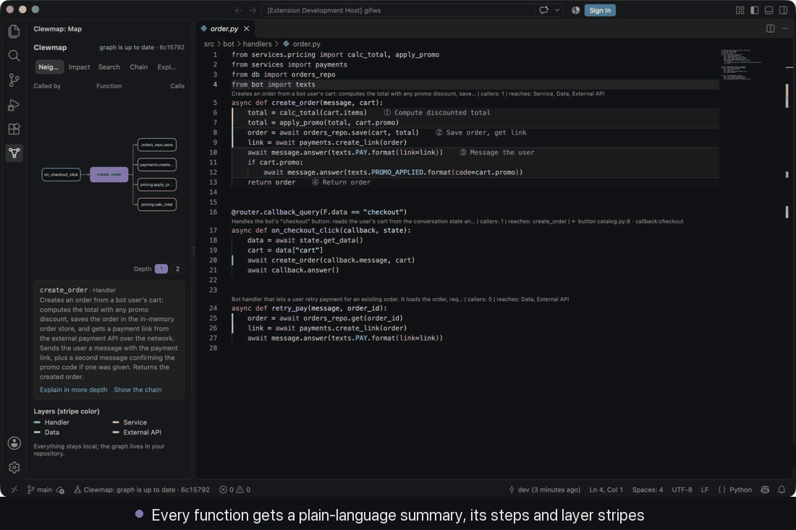
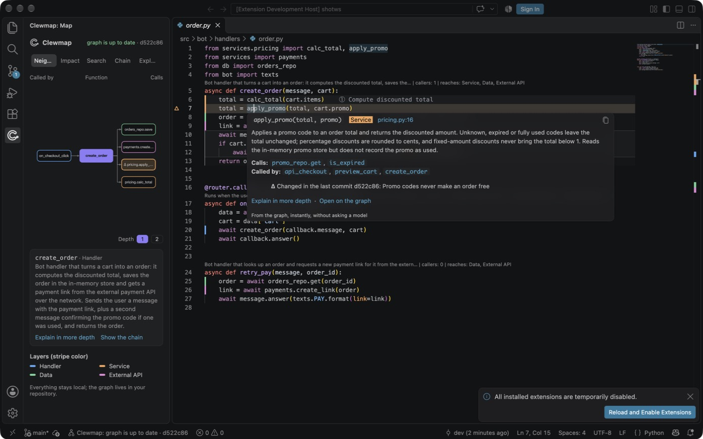
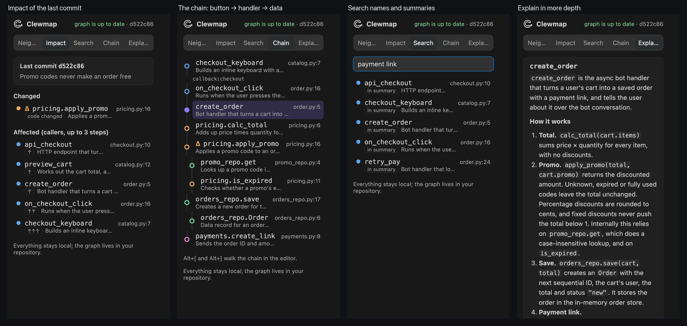

<p align="center">
  
</p>

<h1 align="center">Clewmap</h1>

<p align="center"><b>Your codebase, explained on hover.</b></p>

Clewmap keeps a map of your repository next to the code: a call graph built by tree-sitter, a short
plain-language summary of every function, and the steps inside long ones. You see it in VS Code or Cursor
as a line above each function and a card when you hover a call. Claude Code and other agents read the
same map over MCP, so they can check what a change breaks before they make it. Git hooks keep it current
on every commit.



## Install

```bash
npx clewmap init --hooks
npx clewmap build
```

The first command writes `clewmap.config.json` and installs the git hooks, the second builds the graph and the summaries.

Then install the **Clewmap** extension: download `clewmap.vsix` from the
[latest release](https://github.com/A1exZabr/clewmap/releases/latest) and run **Extensions: Install from
VSIX…** in VS Code or Cursor (the Marketplace listing is next). In Claude Code:

```
/plugin install clewmap --marketplace A1exZabr/clewmap
```

`clewmap build` indexes the code and writes the summaries. On the 8-file example in `fixtures/py-bot`
the graph takes about 0.1 s and the 17 summaries take 45 s. Commit `clewmap.config.json` and `.clewmap/`
so the whole team gets the map; for teams, `npm i -D clewmap` keeps the hooks working without a global
install.

## What you get in the editor



- A line above every function: its summary, how many places call it, and which layers it reaches
  ("reaches: Service, Data, External API"). Click to list callers or callees.
- A hover card on calls and function names: signature, layer, summary, callers, callees, and a note when
  the last commit changed it. It comes from the graph, never from a model: 0.12 ms inside the extension
  in my measurements.
- The steps of long functions, as an alternating background with a label on the first line of each step
  ("① Compute discounted total"). The model only groups statements; the boundaries come from tree-sitter.
- A colored stripe on lines that call into another layer, and a Δ on what the last commit touched.
- F12 on `fetch('/api/checkout')` or `callback_data="checkout"` opens the handler on the other side, from
  TypeScript to Python if that is where it lives. Shift+F12 on a handler lists every button and request
  that reaches it.
- A side panel with the neighbors graph, the impact of the last commit, search over names and summaries,
  the chain from an entry point down to the database (Alt+[ and Alt+] walk it), and "Explain in more
  depth", which asks your model once and caches the answer for that version of the code.



When you edit a file without saving, the extension parses it again with the same tree-sitter grammars,
so everything stays on the right lines and a changed function is marked as ahead of the graph.

## What agents get

`npx clewmap mcp` is a stdio MCP server; the Claude Code plugin starts it for you. Tools:

| Tool | Answers |
| --- | --- |
| `clewmap_impact` | what a change touches: callers up to 3 steps, their files, and the routes, bot commands and buttons it reaches. With no arguments it reads `git diff HEAD` |
| `clewmap_find_callers`, `clewmap_find_callees` | who calls a function and what it calls, up to 3 steps, across language boundaries |
| `clewmap_get_symbol` | signature, location, summary, steps, callers and callees in one call |
| `clewmap_search` | fuzzy search over names and summary text |
| `clewmap_module_summary` | what a file contains |
| `clewmap_status`, `clewmap_update` | whether the graph matches the files, and a refresh of the edges |

The plugin also ships a skill that tells Claude to call `clewmap_impact` before changing a function and to
start exploring with search instead of grep. Asked "what breaks if I change apply_promo?" on the example
bot, Claude called `clewmap_impact` and `clewmap_find_callers` and named the checkout API route, the two
bot handlers and the button that leads to them.

## How it stays current

1. pre-commit runs `clewmap update --staged`: only changed files are parsed again, edges are rebuilt for
   the whole project, and `.clewmap/` goes into the same commit. It took 0.5 s on the example. If anything
   fails, the commit still goes through.
2. post-commit starts `clewmap summarize` in the background. Only new and changed functions are sent to
   the model; a summary is cached by the hash of the function body, so reformatting or editing comments
   costs nothing. Callers of a function whose signature changed are marked stale and refreshed later.
3. Optionally, a [GitHub Action](docs/github-action.md) updates the map for commits made without the hooks.

If you would rather have the summaries in the same commit, set `"hooks": { "summarize": "pre-commit" }`.
The commit then waits for the model, up to `summarizeTimeout` seconds (120 by default).

## Everything stays local

The graph is plain JSON in your repository, one file per source file, outgoing edges only, so diffs stay
small and merge conflicts stay local. The format is documented in
[docs/graph-format.md](docs/graph-format.md) and any tool can read it. There is no server and no
telemetry. Code goes only to the summary provider you choose:

- `claude-cli` (default): `claude -p` on your Claude Code subscription, no API key. About 1.7k input and
  0.4k output tokens for one function, 5.6k and 2.3k for a batch of 17.
- `anthropic`: the Anthropic API with `ANTHROPIC_API_KEY` from your environment. About 1.1k and 0.4k
  tokens for one function, 4.7k and 2.0k for 17.
- `ollama`: a local model, nothing leaves the machine.

Python, TypeScript and JavaScript are supported today, including FastAPI, Flask, Express, Next.js routes,
aiogram and python-telegram-bot handlers.

## How it compares

| Tool | What it is | Clewmap's angle |
| --- | --- | --- |
| Understand Anything | MIT; a plugin for Claude Code and other agents that builds a knowledge graph and opens it in a dashboard in the browser | explanations inside the editor, on hover, refreshed on every commit |
| CodeViz | a VS Code extension with visual codebase maps; closed source, free and paid tiers | MIT, local, no account |
| DeepWiki | a generated wiki for a repository on the web and over MCP; private repositories go through a Devin account | inside the editor, private code stays on your machine |
| Lodestar | a paid VS Code extension: hover explanations and question-driven code maps | a persistent call graph committed with the code, cross-language jumps, git hooks |
| Graph-It-Live | MIT; import graphs, call hierarchies, circular dependencies and dead code in VS Code | a plain-language summary of every function, layers, the impact of a commit, frontend-to-backend links |

These descriptions are short and may be out of date; corrections are welcome in an issue.

## CLI

| Command | |
| --- | --- |
| `clewmap init [--hooks]` | create `clewmap.config.json`, detect languages and layers, install hooks |
| `clewmap build [--no-summaries]` | full index, then summaries |
| `clewmap update [--staged \| --since <ref>]` | re-index changed files, never calls a model |
| `clewmap summarize [--all \| --stale] [--provider <name>]` | write summaries for the queue |
| `clewmap status` | is the graph current, how many summaries are missing |
| `clewmap hook install \| uninstall` | git hooks (husky is supported) |
| `clewmap mcp` | the MCP server over stdio |

`CLEWMAP_SKIP=1` turns the hooks off for one command.

## Contributing

Issues and pull requests are welcome; see [CONTRIBUTING.md](CONTRIBUTING.md). Development:

```bash
pnpm install
pnpm build
pnpm test
```

MIT license.
