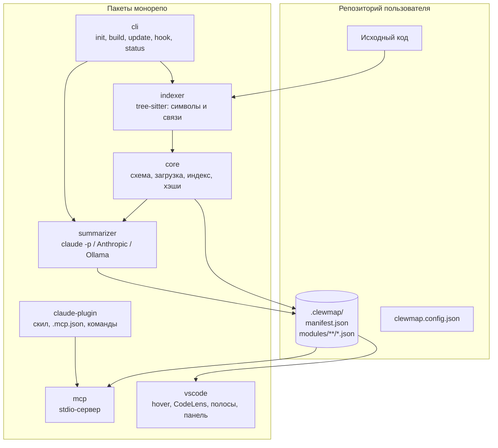
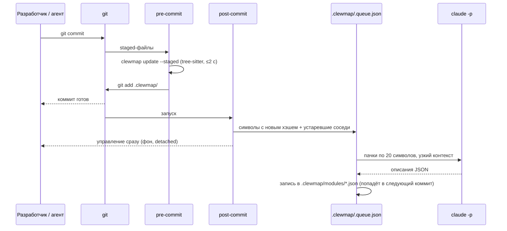

# План реализации: Clewmap

**Стек:** TypeScript · Node.js 20+ · pnpm workspaces · web-tree-sitter · Claude Code CLI (headless) · @modelcontextprotocol/sdk (stdio) · VS Code Extension API · Preact + Cytoscape.js · Vitest
**Тип проекта:** developer tool (CLI + расширение редактора + MCP-сервер + плагин Claude Code), open source MIT
**Целевой результат MVP:** в репозитории на Python или TS команда `clewmap init` строит граф; после каждого коммита граф обновляется сам; в VS Code при наведении на вызов функции видно её описание простым языком, над функциями стоят строки-описания, у строк цветные полосы слоёв, в боковой панели мини-граф и влияние коммита; Claude Code через MCP отвечает «кто вызывает X» и «что сломается, если поменять X».

Видение продукта и макеты: `docs/clewmap-vision.md`, `docs/mockups/editor.html`, `docs/mockups/flow.html`. Открой макеты в браузере перед фазой 3: UI должен им соответствовать.

---

## 📋 Перед началом — контекст для ИИ

```
Проект: Clewmap (имя проверено 22.11.2026: свободно в npm, VS Code Marketplace, Open VSX, на GitHub нет репозиториев и аккаунта с таким именем; clew — клубок нити Ариадны)
Цель: живая карта кода в репозитории + объяснения функций прямо в редакторе + MCP для агентов
Стек: TS монорепо (pnpm), web-tree-sitter, claude -p, MCP stdio, VS Code API, Preact + Cytoscape.js, Vitest
Главное ограничение: всё работает локально, без сервера автора; токены тратятся только на описания и только для изменённого кода
Всегда делать:
  - связи (вызовы, импорты) строить детерминированно через tree-sitter, LLM только пишет тексты описаний
  - хранить граф по одному JSON на исходный файл, только исходящие связи; обратные связи строить в памяти
  - кэшировать описания по хэшу кода символа; не вызывать LLM, если хэш не изменился
  - git-хуки никогда не блокируют коммит дольше пары секунд и никогда не роняют его при ошибке
  - схему графа описывать в одном месте (packages/core) и валидировать (zod) при чтении
  - писать тесты на индексатор и инкрементальное обновление на фикстурах
Никогда не делать:
  - не отправлять код на сторонние серверы, кроме выбранного пользователем LLM-провайдера
  - не встраивать обязательную телеметрию
  - не вызывать LLM при наведении курсора (только явная кнопка «Объяснить подробнее»)
  - не хранить API-ключи в репозитории или в .clewmap/
  - не делать один гигантский JSON графа
```

---

## Архитектура (держать в голове)





---

## Фаза 0 — Подготовка окружения

**Результат фазы:** монорепо собирается, тесты запускаются, CI зелёный.

### 0.1 Структура проекта
```
clewmap/
├── CLAUDE.md
├── LICENSE                      # MIT
├── README.md
├── package.json                 # workspaces, общие скрипты
├── pnpm-workspace.yaml
├── tsconfig.base.json
├── docs/
│   ├── clewmap-vision.md
│   ├── clewmap-ai-plan.md
│   ├── graph-format.md          # спецификация формата (фаза 1)
│   └── mockups/{editor,flow}.html
├── packages/
│   ├── core/                    # схема графа, загрузка, индекс, хэши
│   ├── indexer/                 # tree-sitter, языковые адаптеры
│   ├── summarizer/              # провайдеры LLM, промпты, очередь
│   ├── cli/                     # бинарь `clewmap`
│   ├── mcp/                     # MCP-сервер (stdio)
│   └── vscode/                  # расширение
├── claude-plugin/               # плагин Claude Code
│   ├── .claude-plugin/plugin.json
│   ├── .mcp.json
│   ├── skills/clewmap/SKILL.md
│   └── commands/
├── action/                      # GitHub Action
│   └── action.yml
└── fixtures/
    ├── py-bot/                  # маленький Python-проект для тестов
    └── ts-app/                  # маленький TS-проект для тестов
```

### 0.2 Инициализация
- [x] Создай корневой `package.json` (`"private": true`, `"packageManager": "pnpm@9"`), `pnpm-workspace.yaml` с `packages/*`, `tsconfig.base.json` (strict, ES2022, moduleResolution bundler)
- [x] Создай пакеты `packages/{core,indexer,summarizer,cli,mcp,vscode}` с `package.json` и `src/index.ts`; имена `@clewmap/core` и т. д.
- [x] Установи dev-зависимости в корень: `typescript@~6.0` (TS 7 без JS API компилятора: на нём падают tsup dts и typescript-eslint), `vitest`, `tsup`, `esbuild`, `eslint`, `prettier`, `@types/node`
- [x] Установи в `core`: `zod`; в `indexer`: `web-tree-sitter` + официальные пакеты `tree-sitter-python`, `tree-sitter-typescript`, `tree-sitter-javascript` (берём только их `.wasm`, нативная сборка отключена через `pnpm.neverBuiltDependencies`; `tree-sitter-wasms` не подходит — собран старым emscripten и не грузится в web-tree-sitter ≥0.25); в `mcp`: `@modelcontextprotocol/sdk`; в `cli`: `commander`, `picocolors`
- [x] Создай `.gitignore`: `node_modules/`, `dist/`, `*.vsix`, `.clewmap/.queue.json`, `.clewmap/.lock`, `.clewmap/.cache/`
- [x] Создай `LICENSE` (MIT, автор: Alexander Zabrodin)

### 0.3 Фикстуры и CI
- [x] Создай `fixtures/py-bot/`: 5–6 файлов (handlers/order.py, services/pricing.py, services/payments.py, db/orders_repo.py, db/promo_repo.py) с функциями `create_order`, `on_checkout_click`, `calc_total`, `apply_promo`, `create_link`, `save` — как в макете
- [x] Создай `fixtures/ts-app/`: 4–5 файлов с классом, методами, стрелочными функциями, импортами по алиасу и `export default`
- [x] Создай `.github/workflows/ci.yml`: pnpm install, build, test, lint на Node 20 (ubuntu, macos, windows) — файл есть, на GitHub ещё не запускался
- [x] Проверь: `pnpm -r build && pnpm test` проходят

---

## Фаза 1 — Ядро и детерминированный граф

**Результат фазы:** `clewmap build` на фикстурах создаёт `.clewmap/` с символами и связями, без LLM.

### 1.1 Схема графа (`packages/core`)
- [ ] Создай `src/schema.ts` со схемами zod и выведенными типами:

```ts
// manifest.json
Manifest = {
  formatVersion: 1,
  generator: string,              // "clewmap@0.1.0"
  languages: string[],
  lastCommit: string | null,      // sha, на котором граф актуален
  updatedAt: string               // ISO
}

// modules/<путь исходника>.json, например modules/src/services/pricing.py.json
ModuleFile = {
  file: string,                   // путь от корня репо
  language: "python" | "typescript" | "javascript",
  fileHash: string,               // sha256 содержимого
  layer: string | null,           // слой файла по правилам конфига
  summary: Summary | null,        // описание модуля
  symbols: SymbolNode[]
}

SymbolNode = {
  id: string,                     // "src/services/pricing.py#apply_promo", для методов "#Cart.total"
  kind: "function" | "method" | "class" | "variable",
  name: string,
  range: { start: [line, col], end: [line, col] },   // 0-based
  signature: string,              // "apply_promo(total, promo)"
  signatureHash: string,
  bodyHash: string,               // sha256 нормализованного тела (без пробелов и комментариев)
  layer: string | null,
  calls: CallEdge[],              // только исходящие
  summary: Summary | null,
  blocks: CodeBlock[] | null      // смысловые блоки тела; null — функция короче порога или блоки ещё не готовы
}

// Смысловой блок внутри функции: «строки 6–9 — считает сумму с промокодом».
// Границы всегда совпадают с границами операторов из tree-sitter: LLM только группирует
// готовые операторы по номерам и пишет подпись, сама строки не выбирает.
CodeBlock = {
  range: { start: [line, col], end: [line, col] },  // от первого до последнего оператора группы
  statements: [number, number],   // индексы первого и последнего оператора верхнего уровня тела
  label: string,                  // 2–6 слов: «считает сумму с промокодом»
  text: string | null,            // 1 предложение подробнее (для hover по блоку)
  forBodyHash: string             // блоки пересчитываются вместе с summary символа
}

CallEdge = {
  target: string,                 // id символа или "external:payments.create_link"
  line: number,
  resolved: boolean,
  kind: "call" | "http" | "event", // call — обычный вызов; http — запрос фронта на маршрут бэка;
                                   // event — кнопка/событие → обработчик (callback_data, onClick, emit)
  via?: string                    // для http/event: что связало, например "POST /api/checkout" или "callback:checkout"
}

// Точки входа, которые индексатор находит у обработчиков (для связей http/event):
SymbolNode.entry?: {
  kind: "http-route" | "bot-callback" | "bot-command" | "event",
  key: string                     // "POST /api/checkout", "callback:checkout", "command:/start"
}

Summary = {
  text: string,                   // 1–3 предложения простым языком
  forBodyHash: string,            // для какой версии кода написано
  stale: boolean,                 // соседи поменяли сигнатуру
  model: string,
  createdAt: string
}
```

- [ ] Создай `src/paths.ts`: путь модуля → путь JSON в `.clewmap/modules/`, обратно; нормализация разделителей под Windows
- [ ] Создай `src/hash.ts`: `sha256(text)`, `normalizeBody(text, language)` (убрать комментарии, схлопнуть пробелы)
- [ ] Создай `src/store.ts`: `readGraph(root)`, `writeModule(root, module)` (атомарно: temp-файл + rename, стабильный порядок ключей и символов, отступ 2), `writeManifest`
- [ ] Создай `src/index.ts` с классом `GraphIndex`: загружает все модули, строит `Map<id, SymbolNode>`, обратные связи `calledBy`, поиск символа по `(file, line)`, `neighbors(id, depth)`, `impact(ids)` (транзитивные вызывающие с ограничением глубины)
- [ ] Создай `docs/graph-format.md`: человеческое описание формата с примером (это часть продукта: формат открытый)
- [ ] Напиши тесты: сериализация стабильна (два прогона дают одинаковые байты), `calledBy` строится верно, поиск по строке

### 1.2 Индексатор (`packages/indexer`)
- [ ] Создай `src/parser.ts`: ленивая инициализация web-tree-sitter, загрузка WASM-грамматик из пакета, кэш парсеров по языку
- [ ] Создай интерфейс `LanguageAdapter { language; extensions; extractSymbols(tree, source); extractImports(tree); extractCalls(node) }` в `src/adapters/types.ts`
- [ ] Реализуй `src/adapters/python.ts` через tree-sitter queries (`.scm`): `function_definition`, `class_definition`, методы внутри классов, `decorated_definition`, `import_statement`, `import_from_statement`, `call` (простые имена и `obj.attr`)
- [ ] Реализуй `src/adapters/typescript.ts` (ts, tsx, js, jsx): `function_declaration`, `method_definition`, `class_declaration`, стрелочные функции в `const`, `export default`, `import` (включая алиасы из `tsconfig.json` paths), `call_expression`
- [ ] Создай `src/resolve.ts`: разрешение вызова в id символа через таблицу импортов файла и локальные определения; не нашёл — `external:<текст вызова>`, `resolved: false`
- [ ] Создай `src/links.ts` — связи между фронтом, бэком и ботом, детерминированно, по совпадению строк:
  - точки входа (`entry`): маршруты FastAPI/Flask (`@app.post("/api/checkout")`, `@router.get`), Express/Hono (`app.post('/api/checkout', handler)`), Next.js API routes по пути файла; aiogram (`F.data == "checkout"`, `Command("start")`), python-telegram-bot (`CallbackQueryHandler(pattern=...)`)
  - вызовы с фронта: `fetch('/api/checkout', { method: 'POST' })`, `axios.post('/api/checkout')`, обёртки вида `api.post(...)` по списку из конфига `links.httpClients`; кнопки бота: `InlineKeyboardButton(callback_data="checkout")`
  - сопоставление: метод + путь (параметры `/orders/{id}` ≈ `/orders/${id}` ≈ `/orders/:id`, базовый префикс из `links.apiPrefix`) или ключ callback; совпало — ребро `kind: "http"`/`"event"` с `via`, нет — `resolved: false`, ничего не выдумывать
  - на фикстурах: кнопка `CheckoutButton` в `ts-app` → `checkout()` → `POST /api/checkout` → `api_checkout` в `py-bot`; страница `Account` → `GET /api/orders/${id}` → `api_get_order`; кнопка «Оформить» бота (`callback_data="checkout"`) → `on_checkout_click`
- [ ] Создай `src/layers.ts`: слой по glob-правилам из `clewmap.config.json` (пример ниже), иначе эвристика по папкам (`handlers|routes|controllers|bot` → handler, `services|domain` → service, `db|repo|models|dao` → data); вызов во внешний SDK (`requests`, `httpx`, `fetch`, `axios`, пакеты платёжек) → слой `external`
- [ ] Создай `src/statements.ts`: для функции/метода — список операторов верхнего уровня тела (диапазон, тип узла tree-sitter, текст); вложенные `if`/`for`/`try`/`with` — один оператор целиком. Это сырьё для смысловых блоков (`CodeBlock`), сами блоки делает фаза 2
- [ ] Создай `src/indexFile.ts`: файл → `ModuleFile` без описаний (`blocks: null`)
- [ ] Создай `src/scan.ts`: обход репо с учётом `.gitignore` и `exclude` из конфига
- [ ] Напиши тесты на фикстурах: ожидаемые символы, связи `create_order → apply_promo`, внешние вызовы, методы классов

```json
// clewmap.config.json (пример, создаётся командой init)
{
  "include": ["src/**"],
  "exclude": ["**/tests/**", "**/migrations/**"],
  "layers": {
    "handler":  { "label": "Обработчик", "color": "#5AA9F5", "globs": ["src/bot/**", "src/api/**"] },
    "service":  { "label": "Сервис",     "color": "#F2A65A", "globs": ["src/services/**"] },
    "data":     { "label": "Данные",     "color": "#6FD69A", "globs": ["src/db/**"] },
    "external": { "label": "Внешний API","color": "#E58AD8", "globs": [] }
  },
  "summaries": { "provider": "claude-cli", "model": null, "language": "ru", "batchSize": 20, "blocksMinLines": 8 },
  "hooks": { "preCommit": true, "postCommit": true }
}
```

### 1.3 CLI: базовые команды (`packages/cli`)
- [ ] Создай `src/bin.ts` с `commander`: `clewmap init`, `clewmap build`, `clewmap status`
- [ ] `init`: создаёт `clewmap.config.json` (определяет языки и папки), `.clewmap/manifest.json`, дописывает в `.gitignore` служебные файлы `.clewmap/`
- [ ] `build`: полная индексация без описаний (флаг `--no-summaries` по умолчанию в этой фазе), печатает число файлов, символов, связей, время
- [ ] `status`: актуален ли граф (`lastCommit` vs `HEAD`, файлы с несовпавшим `fileHash`), сколько символов без описаний и с `stale`

**✅ Проверка фазы 1:** `cd fixtures/py-bot && clewmap init && clewmap build` создаёт `.clewmap/modules/…/order.py.json`, где у `create_order` есть связь на `src/services/pricing.py#apply_promo`; повторный `build` не меняет ни одного байта. На общем корне фикстур кнопка из `ts-app` связана ребром `http` (`via: "POST /api/checkout"`) с обработчиком в `py-bot`.

---

## Фаза 2 — Описания и инкрементальное обновление

**Результат фазы:** у каждого символа есть описание; после изменения одной функции пересчитывается только она и помечаются устаревшими её вызывающие; хуки работают.

### 2.1 Провайдеры описаний (`packages/summarizer`)
- [ ] Создай интерфейс `SummaryProvider { name; summarize(batch: SummaryRequest[]): Promise<SummaryResult[]> }`
- [ ] Реализуй `ClaudeCliProvider`: запуск `claude -p "<промпт>" --output-format json` через `child_process.spawn` без shell, промпт передавать через stdin; таймаут; разбор JSON-ответа; если `claude` нет в PATH — понятная ошибка с подсказкой
- [ ] Реализуй `AnthropicApiProvider` (ключ из `ANTHROPIC_API_KEY`, только из окружения) и `OllamaProvider` (`http://localhost:11434`)
- [ ] Создай `src/prompt.ts`. Контекст на символ узкий: код символа, его сигнатура, имена и уже готовые описания вызываемых (1 шаг), имя файла и слой. Ответ строго JSON: `[{ "id": "...", "summary": "..." }]`. Требования к тексту: 1–3 предложения, простой язык, что делает и что возвращает, побочные эффекты (БД, сеть, файлы), без пересказа кода построчно, язык из конфига
- [ ] Смысловые блоки в том же запросе, что и описание: для функций длиннее `summaries.blocksMinLines` (по умолчанию 8 строк) в промпт идут пронумерованные операторы тела, модель возвращает `blocks: [{ "from": 0, "to": 2, "label": "...", "text": "..." }]`. Валидация: группы идут подряд, без дыр и пересечений, покрывают все операторы, 2–7 блоков на функцию; невалидный ответ — блоки отбросить, описание оставить. Диапазоны строк вычислять из операторов tree-sitter, не из ответа модели
- [ ] Создай `src/order.ts`: порядок обработки снизу вверх по графу вызовов (листья первыми), чтобы у вызывающих уже были описания вызываемых
- [ ] Создай `src/queue.ts`: очередь в `.clewmap/.queue.json`, блокировка `.clewmap/.lock` (PID + время, снятие протухшей блокировки), пачки по `batchSize`, повтор с экспоненциальной паузой, частичная запись результатов после каждой пачки
- [ ] Напиши тесты с фейковым провайдером: порядок листья → корни, повтор при ошибке, частичный прогресс сохраняется

### 2.2 Инкрементальное обновление
- [ ] Создай `packages/core/src/diff.ts`: сравнение старого и нового `ModuleFile` → новые, удалённые, изменённые символы (по `bodyHash`), символы со сменой `signatureHash`
- [ ] Реализуй в CLI `clewmap update [--staged | --since <ref> | --files ...]`: переиндексировать только эти файлы; перенести существующие описания, где `bodyHash` совпал; где не совпал — поставить в очередь; всем вызывающим символа со сменённой сигнатурой поставить `summary.stale = true` и поставить их в очередь с низким приоритетом
- [ ] Обработай переименование и перемещение файла (`git diff --name-status -M`): перенести JSON, обновить id и связи в зависимых модулях
- [ ] Обработай удаление файла: удалить JSON, связи на его символы в других модулях пометить `resolved: false`
- [ ] Реализуй `clewmap summarize [--all | --stale | --limit N] [--background]`: разбирает очередь; `--background` — отсоединённый процесс (`detached: true`, `stdio: ignore`, `unref()`), лог в `.clewmap/.cache/summarize.log`
- [ ] Обнови `manifest.lastCommit` после успешного обновления

### 2.3 Git-хуки
- [ ] Реализуй `clewmap hook install | uninstall`: пишет `.git/hooks/pre-commit` и `post-commit` (sh-скрипт, совместимый с Windows Git Bash); если хук уже существует — дописывает свой блок между маркерами `# >>> clewmap` / `# <<< clewmap`, не затирая чужой; поддержка husky (определить `.husky/` и писать туда)
- [ ] pre-commit: `clewmap update --staged --quiet && git add .clewmap/`; общий таймаут 5 с; при любой ошибке печатает предупреждение и выходит с кодом 0 (коммит не блокируется)
- [ ] post-commit: `clewmap summarize --background` и сразу выход
- [ ] Переменная `CLEWMAP_SKIP=1` отключает хуки (для rebase и массовых операций); во время `rebase`, `merge`, `cherry-pick` хуки ничего не делают
- [ ] Команда `init` предлагает установить хуки (флаг `--hooks`)

**✅ Проверка фазы 2:** у `create_order` (длиннее 8 строк) есть 2–7 блоков, границы которых совпадают с операторами, а подписи осмысленные. В `fixtures/py-bot` поменяй тело `apply_promo` и закоммить: коммит проходит меньше чем за 2 с; в `pricing.py.json` у `apply_promo` новый `bodyHash`; через минуту у неё новое описание; у `create_order` описание не пересчитано (хэш не менялся). Поменяй сигнатуру `apply_promo`: у `create_order` и `preview_cart` появляется `stale: true`.

---

## Фаза 3 — Расширение VS Code / Cursor

**Результат фазы:** UI как на `docs/mockups/editor.html`: строки над функциями, подсказки при наведении, полосы слоёв, боковая панель.

### 3.1 Каркас (`packages/vscode`)
- [ ] Создай `package.json` расширения: `engines.vscode ^1.90.0`, `activationEvents` по наличию `.clewmap/manifest.json` (`workspaceContains`), `contributes`: команды, настройки, view container в Activity Bar с webview view `clewmap.panel`, иконка
- [ ] Создай `src/extension.ts`: загрузка `GraphIndex` из `@clewmap/core`, `FileSystemWatcher` на `.clewmap/**/*.json` с дебаунсом 300 мс и перезагрузкой изменённого модуля
- [ ] Создай `src/locate.ts`: символ под курсором и символ вызова по позиции. Если документ изменён и не сохранён или `fileHash` не совпадает, сопоставлять символы по имени и сигнатуре, а не по номерам строк; при неуверенности показывать пометку «граф устарел для этого файла»
- [ ] Настройки: `clewmap.codeLens.enabled`, `clewmap.hover.enabled`, `clewmap.layerStripes.enabled`, `clewmap.summaryLanguage`

### 3.2 Строка над функцией (CodeLens)
- [ ] Реализуй `CodeLensProvider` в `src/codelens.ts`: над каждым символом три линзы: (1) описание, обрезанное до ~90 символов (полное в tooltip); (2) «вызывают: N» → команда `clewmap.showCallers` (QuickPick с переходом); (3) «ходит в: …» — уникальные слои и внешние сервисы среди вызываемых → `clewmap.showCallees`
- [ ] Нет описания — «описание ещё не готово»; `stale` — пометка «устарело»

### 3.3 Подсказка при наведении (Hover)
- [ ] Реализуй `HoverProvider` в `src/hover.ts`: при наведении на вызов или имя символа — `MarkdownString` (`isTrusted` только для своих command-ссылок): сигнатура, плашка слоя, `файл:строка`, описание, «Вызывает: …», «Вызывают: …» (ссылки-команды на переход), блок «Изменена в последнем коммите <sha>», если символ есть в последнем diff; ссылки «Объяснить подробнее» и «Открыть на графе»
- [ ] Hover никогда не вызывает LLM: только данные из индекса, время ответа < 20 мс

### 3.3a Переходы по цепочке между файлами
- [ ] `DefinitionProvider` и `ReferenceProvider` поверх графа: F12 / Cmd+клик на `fetch('/api/checkout')` или `callback_data="checkout"` открывает обработчик на бэке; Shift+F12 на обработчике показывает все кнопки и запросы, которые в него ведут. Работает между языками (TS → Python), где обычный LSP бессилен
- [ ] В hover и CodeLens рёбра `http`/`event` показаны отдельно: «← кнопка CheckoutButton.tsx:14 · POST /api/checkout», клик — переход
- [ ] Команда «Показать цепочку» (`clewmap.showFlow`): от символа вверх до точки входа (кнопка, маршрут, команда бота) и вниз до данных и внешних API; в панели — путь из узлов «Кнопка → API → create_order → payments.create_link → orders_repo.save», клик по узлу открывает файл
- [ ] Навигация «назад/вперёд» по цепочке: `Alt+[` / `Alt+]` прыгают к предыдущему/следующему звену текущей цепочки

### 3.4 Полосы слоёв и пометка изменений
- [ ] Создай `src/decorations.ts`: по одному `TextEditorDecorationType` на слой (цвет из конфига): узкая полоса слева (`borderWidth: 0 0 0 3px` по всей строке) и метка в `overviewRuler`
- [ ] Каждой строке с вызовом назначить слой вызываемого символа; несколько вызовов на строке — слой первого
- [ ] Отдельная декорация для символов, изменённых в последнем коммите: метка «Δ» в gutter (SVG-иконка) и лёгкая подсветка фона
- [ ] Подсветка смысловых блоков (`CodeBlock`): чередующийся очень лёгкий фон у соседних блоков (два оттенка из темы, чтобы границы читались), тонкая разделительная линия между блоками и подпись блока серым текстом в конце первой строки блока (`after`-декорация, «① считает сумму с промокодом»); hover по любой строке блока показывает `label` + `text`. Настройки `clewmap.blocks.enabled` и `clewmap.blocks.style` (`tint` | `label` | `both`)
- [ ] Обновлять декорации при смене активного редактора, сохранении и перезагрузке графа

### 3.5 Боковая панель (webview)
- [ ] Создай `src/panel/PanelProvider.ts` (`WebviewViewProvider`) с CSP без внешних ресурсов; общение через `postMessage`
- [ ] Создай `webview/` на Preact + Cytoscape.js (собирать esbuild в один файл): вкладки «Соседи», «Влияние», «Поиск»
- [ ] «Соседи»: символ под курсором в центре, слева вызывающие, справа вызываемые, глубина 1 (переключатель 2), цвет рамки по слою, изменённые помечены «Δ»; клик по узлу открывает файл на строке
- [ ] «Влияние»: последний коммит (sha, изменённые символы, транзитивно затронутые с глубиной 3), список `stale`
- [ ] «Поиск»: нечёткий поиск по именам и по тексту описаний (без LLM)
- [ ] Легенда слоёв и строка «граф актуален / отстаёт на N коммитов»
- [ ] Тема: только CSS-переменные VS Code (`--vscode-*`), чтобы работало в светлой и тёмной теме

### 3.6 «Объяснить подробнее»
- [ ] Команда `clewmap.explainDeeper(id)`: собирает узкий контекст (код символа + описания соседей на 1–2 шага + описание модуля), вызывает провайдер из `@clewmap/summarizer`, показывает ответ в панели с индикатором загрузки
- [ ] Сохраняет ответ в `.clewmap/.cache/explanations/<id-hash>.json` с `forBodyHash`; при совпадении хэша показывает из кэша без запроса
- [ ] Строка состояния: «Clewmap: граф актуален · <sha>», клик открывает панель

**✅ Проверка фазы 3:** открыть `fixtures/py-bot` в Extension Development Host. Над `create_order` строка с описанием и счётчиками; тело `create_order` разбито на подсвеченные блоки с подписями; наведение на `apply_promo` показывает подсказку как в макете; у строк 6–10 цветные полосы; панель показывает соседей; после коммита с изменением `apply_promo` в панели «Влияние» видны затронутые функции. Проверить в Cursor (установка `.vsix`).

---

## Фаза 4 — MCP, плагин Claude Code, GitHub Action

**Результат фазы:** Claude Code через MCP пользуется графом; плагин ставится одной командой; граф в `main` обновляется в CI.

### 4.1 MCP-сервер (`packages/mcp`)
- [ ] Создай `src/server.ts` на `@modelcontextprotocol/sdk`, транспорт stdio; корень репо из `cwd` (поиск `.clewmap/` вверх до корня git); запуск через `clewmap mcp` (подкоманда CLI)
- [ ] Инструменты (входы валидировать zod, ответы компактные, без огромных дампов):
  - `clewmap_get_symbol({ name | id })` → сигнатура, файл:строка, слой, описание, stale
  - `clewmap_find_callers({ id, depth?=1 })`
  - `clewmap_find_callees({ id, depth?=1 })`
  - `clewmap_impact({ ids? | diff? })` → транзитивно затронутые символы и файлы, глубина ≤ 3, лимит 50 с пометкой об обрезке
  - `clewmap_search({ query, limit?=20 })` → по именам и описаниям
  - `clewmap_module_summary({ file })` → описание модуля и список символов
  - `clewmap_status()` → актуальность графа, число stale и без описаний
  - `clewmap_update({ files? })` → запустить инкрементальное обновление связей (без LLM)
- [ ] Перезагрузка индекса при изменении файлов `.clewmap/` (watcher)
- [ ] Тесты: вызов каждого инструмента на фикстуре через in-memory транспорт

### 4.2 Плагин Claude Code (`claude-plugin/`)
- [ ] Создай `.claude-plugin/plugin.json` (имя, версия, описание, автор, лицензия MIT) и marketplace-манифест в корне репо, чтобы работало `/plugin marketplace add <owner>/clewmap`
- [ ] Создай `.mcp.json`: сервер `clewmap`, команда `npx -y clewmap mcp`
- [ ] Создай `skills/clewmap/SKILL.md`: перед изменением функции вызвать `clewmap_impact` и `clewmap_find_callers`; при знакомстве с проектом начинать с `clewmap_search` и `clewmap_module_summary`, а не с grep по всем файлам; после правок не трогать `.clewmap/` вручную (хуки обновят сами)
- [ ] Создай команды: `commands/clewmap-init.md` (init + build + summarize + установка хуков), `commands/clewmap-explain.md` (подробное объяснение символа)
- [ ] Проверь установку плагина в чистом Claude Code и вызов инструментов

### 4.3 GitHub Action (`action/`)
- [ ] Создай `action.yml` (composite): checkout, Node, `npx clewmap update --since ${{ github.event.before }}`; описания опционально (секрет `ANTHROPIC_API_KEY`, провайдер `anthropic-api`); коммит изменений `.clewmap/` ботом с `[skip ci]`
- [ ] Пример workflow в `docs/github-action.md`

**✅ Проверка фазы 4:** в Claude Code с установленным плагином на `fixtures/py-bot` спросить «что сломается, если поменять apply_promo?» — агент вызывает `clewmap_impact` и называет `create_order` и `preview_cart`. Action на тестовом репо после пуша коммитит обновлённый `.clewmap/`.

---

## Фаза 5 — Релиз и запуск

**Результат фазы:** пакеты опубликованы, README продаёт с первого экрана, проект запущен в сообществах.

### 5.1 Упаковка
- [x] Имя проверено 22.11.2026: `clewmap` свободно в npm, VS Code Marketplace, Open VSX, GitHub (репо и аккаунт). Перед публикацией перепроверить и проверить товарные знаки (USPTO, WIPO); занять `github.com/clewmap` и npm-имя заранее
- [ ] Публикация CLI в npm одним пакетом `clewmap` (бинарь `clewmap`, включает mcp-подкоманду, WASM-грамматики в пакете)
- [ ] Сборка `.vsix` через `@vscode/vsce`; публикация в VS Code Marketplace и Open VSX (`ovsx`) — Cursor и Windsurf берут оттуда
- [ ] Workflow `release.yml`: по тегу `v*` собирает и публикует всё; changesets для версий

### 5.2 README (главный маркетинговый актив)
- [ ] Первый экран: название, слоган «Your codebase, explained on hover», GIF 10–15 с: наведение на вызов → подсказка; коммит → панель «Влияние» обновилась
- [ ] Установка в 3 строки: `npx clewmap init --hooks`, расширение из Marketplace, `/plugin marketplace add …`
- [ ] Блоки: «Всё локально», «Работает с подпиской Claude Code, без API-ключа», «Обновляется на каждом коммите», сравнение с альтернативами (честно), формат графа открыт
- [ ] `CONTRIBUTING.md`, шаблоны issue, `CODE_OF_CONDUCT.md`; включить GitHub Sponsors; CLA-бот (до первых внешних PR)

### 5.3 Запуск
- [ ] Один день: Show HN, r/ClaudeAI, r/vscode, r/programming (если правила позволяют), X, Хабр (статья с историей «зачем»)
- [ ] Discussion или issue в Understand Anything с предложением совместимости (после фазы v2 с адаптером)

**✅ Финальная проверка:** на чистой машине: `npx clewmap init --hooks` в своём реальном проекте → установить расширение → навести на вызов → подсказка; сделать коммит → граф обновился; Claude Code с плагином отвечает на вопрос о влиянии изменения.

---

## 🐛 Типовые проблемы и решения

| Проблема | Решение |
|---------|---------|
| Нативные модули tree-sitter не собираются у пользователей | Только `web-tree-sitter` (WASM), грамматики `.wasm` внутри пакета. При публикации CLI (фаза 5) копировать `.wasm` в сам пакет, а не тянуть пакеты грамматик с их `node-gyp-build` |
| `Language.load` падает в `getDylinkMetadata` | Грамматика собрана другим emscripten, чем рантайм; держать версии `web-tree-sitter` и грамматик из одной эпохи, тест `parser.test.ts` ловит это сразу |
| Хук замедляет коммиты | pre-commit только связи для staged-файлов с таймаутом; описания всегда в фоне |
| Хук ломает rebase / merge | Пропуск при `.git/rebase-merge`, `.git/MERGE_HEAD`, `CLEWMAP_SKIP=1` |
| Merge-конфликты в `.clewmap/` | Файл на модуль, стабильная сортировка, только исходящие связи; команда `clewmap resolve` — пересобрать конфликтные модули из кода |
| Номера строк в графе не совпадают с несохранённым буфером | Сопоставление по имени и сигнатуре, пометка «устарело» |
| LLM придумывает факты в описании | Узкий контекст, запрет на догадки в промпте, связи только из tree-sitter, никогда из LLM |
| Неразрешённые вызовы (динамика, `getattr`, DI) | Помечать `resolved: false`, показывать как внешние, не выдумывать связь |
| `claude` не установлен или не залогинен | Понятная ошибка + переключение на `anthropic-api` / `ollama` в конфиге; граф связей работает и без описаний |
| Большой монорепо: долгий первый прогон описаний | Описания по запросу: сначала только публичные символы и модули, остальное фоном с лимитом в день (`summaries.dailyLimit`) |
| Параллельные процессы пишут граф | Блокировка `.clewmap/.lock`, атомарная запись через rename |
| Windows-пути в id символов | В id всегда `/`, нормализация в `core/paths.ts` |

---

## 📝 Заметки по коду

- **Именование:** пакеты `@clewmap/<name>`; инструменты MCP с префиксом `clewmap_`; команды VS Code `clewmap.<action>`; id символа `путь/от/корня.py#Class.method`
- **Обработка ошибок:** CLI и хуки никогда не падают с трассировкой у пользователя: понятное сообщение + код выхода; хуки всегда выходят с 0; ошибки провайдера LLM — повтор, затем пропуск символа с записью в лог
- **Логирование:** `debug` через переменную `CLEWMAP_DEBUG=1`; фоновый процесс пишет в `.clewmap/.cache/summarize.log` с ротацией; расширение — в свой Output Channel «Clewmap»
- **Тесты:** обязательно индексатор (обе фикстуры), diff и инкрементальное обновление, порядок очереди, стабильность сериализации, инструменты MCP; UI расширения — smoke-тест через `@vscode/test-electron`
- **Производительность:** загрузка графа на 5 000 файлов < 1 с; hover < 20 мс; pre-commit на 10 файлов < 2 с
- **Безопасность:** вызов `claude` и `git` только через `spawn` с массивом аргументов, без shell; в webview строгий CSP; описания из графа в hover экранировать (это данные из репозитория, они могут содержать что угодно)

---

*Документ создан: 2026-11-22*
*Версия плана: v1.0 (MVP)*
