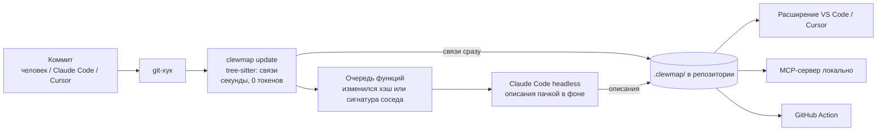

# Clewmap

> Живая карта кода: объяснение любой функции при наведении курсора, граф связей, который обновляется на каждом коммите, и MCP, через который ИИ-агенты ориентируются в проекте.

## 🎯 Проблема

ИИ-агенты пишут код быстрее, чем люди успевают его понимать. Проект за пару месяцев превращается в лабиринт: дублирование, неочевидные связи, функции, о которых никто не помнит, что они делают. Существующие инструменты визуализации строят разовый снимок в отдельном окне браузера, а через пару коммитов он уже устарел. В самом редакторе, где человек читает код, объяснений нет: каждый раз приходится выделять кусок и спрашивать модель, тратить время и токены, а ответ потом теряется.

## 👥 Целевая аудитория

**Основной сегмент:** разработчики, которые активно пишут с ИИ-агентами (Claude Code, Cursor, Copilot) и регулярно теряют общую картину своего проекта. Соло-разработчики, фрилансеры, небольшие студии, которые принимают чужие проекты.
**Вторичный сегмент:** тимлиды и новички в команде (онбординг в незнакомый код), владельцы проектов, у которых ушёл разработчик.
**Боль, которую мы закрываем:** «открыл файл и не понимаю, что делает функция, кто её вызывает и что сломается, если её поменять», и всё это без похода в браузер и без ожидания ответа модели.

## 💡 Решение

Open source (MIT) набор из четырёх частей вокруг одного графа кода, который хранится в репозитории:

1. **CLI-движок** строит граф: точные связи через tree-sitter (без LLM), а описания простым языком пишет Claude Code в headless-режиме.
2. **Git-хуки** обновляют граф инкрементально на каждом коммите: связи сразу, описания в фоне. Ничего не надо навёрстывать.
3. **Расширение VS Code / Cursor** показывает граф прямо в коде: описание над каждой функцией, подсказка при наведении на вызов, цветная полоса слоя у строки, мини-граф соседей в боковой панели, подсветка того, что задел последний коммит.
4. **Локальный MCP-сервер и плагин Claude Code**: агент перед правкой спрашивает граф «кто вызывает» и «что сломается».

Всё работает локально: код не уходит на чужой сервер, токены тратятся из подписки или ключа самого пользователя, у автора нет серверной нагрузки.

**Ключевая ценность:** понимаешь любую функцию за секунду, не выходя из редактора, и карта никогда не устаревает.

## 🖼️ Как это выглядит

Интерактивные макеты лежат рядом: `mockups/editor.html` (редактор) и `mockups/flow.html` (схема обновления). Открыть в браузере.

```
┌─ Как читать: (1) описание над функцией (2) подсказка при наведении (3) полоса слоя (4) панель ─┐
├──────────────┬──────────────────────────────────────────────────────┬────────────────────────┤
│ ПРОВОДНИК    │ src › bot › handlers › order.py                      │ (4) Clewmap  ● актуален │
│ ● order.py   │   1  from services.pricing import calc_total, ...    │ [Соседи][Влияние][Поиск]│
│ ● catalog.py │  (1) Принимает корзину, считает сумму, сохраняет     │                         │
│ ● pricing.py │      заказ и шлёт ссылку на оплату · вызывают: 2 ·   │ on_checkout ┐   calc_total
│   изм.       │      ходит в: БД, платёжный API                      │             ├create_order─Δ apply_promo
│ ● payments.py│   5  async def create_order(message, cart):          │ retry_pay  ─┘   orders.save
│ ● orders_repo│ ▌ 6      total = calc_total(cart.items)              │                 create_link
│              │ ▌Δ7      total = apply_promo(total, cart.promo)      │ (3) Слои: ▬ Обработчик  │
│ .clewmap/    │ ▌ 8   ┌─(2)─ apply_promo(total, promo) · Сервис ───┐ │  ▬ Сервис ▬ Данные ▬ API│
│              │ ▌ 9   │ Применяет промокод к сумме заказа. Проверяет│ │                         │
│              │ ▌10   │ срок и лимит, вычитает процент или фикс.    │ │ Коммит a3f9c1:          │
│              │       │ Вызывает: promo_repo.get, is_expired        │ │ изменена apply_promo,   │
│              │       │ Вызывают: create_order, preview_cart        │ │ затронуты 2 функции.    │
│              │       │ [Объяснить подробнее] [Открыть на графе]    │ │ preview_cart: устарело  │
│              │       └─────────────────────────────────────────────┘ │                         │
├──────────────┴──────────────────────────────────────────────────────┴────────────────────────┤
│ ● Clewmap: граф актуален · a3f9c1   MCP: подключён к Claude Code   Всё локально              │
└──────────────────────────────────────────────────────────────────────────────────────────────┘
▌ = цветная полоса слоя у строки, Δ = строка изменена в последнем коммите
```



## ⚡ MVP — Ключевые функции

| Функция | Описание | Приоритет |
|---------|----------|-----------|
| Индексатор связей | tree-sitter разбирает Python и TypeScript/JavaScript: функции, классы, методы, импорты, вызовы. Детерминированно, без LLM | Must have |
| Формат графа `.clewmap/` | Один JSON на исходный файл, открытая документированная схема, хранится в git | Must have |
| Описания функций | Короткое описание на каждый символ через `claude -p`, кэш по хэшу кода, пачками | Must have |
| Инкрементальное обновление | Только изменённые файлы; пометка «устарело» у вызывающих при смене сигнатуры | Must have |
| Git-хуки | pre-commit: связи для staged-файлов; post-commit: описания в фоне, коммит не ждёт | Must have |
| Подсказка при наведении | Описание вызова, слой, кто вызывает и кого вызывает, мгновенно из графа | Must have |
| Строка над функцией | «что делает · вызывают: N · ходит в: …», клик ведёт по связям | Must have |
| Переходы по цепочке | Клик от кнопки на фронте к API-обработчику, оттуда к логике корзины, платежу, ЛК; связи фронт↔бэк↔бот по маршрутам и callback_data, между языками | Must have |
| Смысловые блоки | Тело функции разбито на подсвеченные блоки с подписью «что делает этот кусок»; границы по операторам tree-sitter, подписи от LLM вместе с описанием | Must have |
| Полоса слоя у строки | Цвет по слою (обработчик / сервис / данные / внешний API), правила в конфиге | Should have |
| Боковая панель | Мини-граф соседей на 1–2 шага, влияние последнего коммита, список устаревших | Should have |
| «Объяснить подробнее» | Узкий контекст: код функции + описания соседей, ответ кэшируется в граф | Should have |
| MCP-сервер | Инструменты для агента: символ, вызывающие, вызываемые, влияние изменения, поиск | Must have |
| Плагин Claude Code | Скил «смотри граф перед правкой», MCP-конфиг, команды `/clewmap-init` | Should have |

**В MVP нет (оставлено на v2):**
- Другие языки кроме Python и TS/JS (Go, Java, C#, Rust): архитектура адаптеров готова, добавляются по спросу.
- Адаптер импорта графа Understand Anything: сначала свой движок, потом совместимость.
- Граф на несколько репозиториев, облако для команд, веб-дашборд.
- JetBrains IDE.

## 🏗️ Технический стек

**Платформа/тип:** developer tool: CLI + расширение редактора + MCP-сервер, монорепо на TypeScript.

| Компонент | Технология | Обоснование |
|-----------|-----------|-------------|
| Язык | TypeScript, Node.js 20+ | Один язык для CLI, MCP и расширения VS Code |
| Монорепо | pnpm workspaces | Общие типы схемы графа между пакетами |
| Парсинг | web-tree-sitter (WASM) + грамматики Python, TS, JS | Без нативной сборки: работает на любой ОС из коробки |
| Описания | Claude Code CLI (`claude -p --output-format json`) | Работает по подписке пользователя без API-ключа; провайдеры Anthropic API и Ollama как запасные |
| Хранилище графа | JSON-файлы в `.clewmap/` | Читается людьми, диффается в git, без БД |
| Индекс в памяти | Map символов + обратные связи, строятся при загрузке | Обратные связи не хранятся в файлах, поэтому нет merge-конфликтов |
| MCP | `@modelcontextprotocol/sdk`, транспорт stdio | Локальный процесс у пользователя, без сервера |
| Расширение | VS Code Extension API, webview на Preact + Cytoscape.js | HoverProvider, CodeLensProvider, декорации; совместимо с Cursor и Windsurf |
| Тесты | Vitest | Быстро, нативно для TS |
| Сборка | tsup (CLI, MCP), esbuild (расширение) | Минимум конфигурации |
| CI | GitHub Actions | Тесты, релизы, Action для пользователей |
| Дистрибуция | npm, VS Code Marketplace, Open VSX, маркетплейс плагинов Claude Code | Бесплатно, нагрузку держат площадки |

## 💰 Монетизация

**Модель:** open-core. Ядро MIT и бесплатно навсегда. До 1–3 тыс. звёзд никакой монетизации, только рост.

| Тариф / Сценарий | Цена | Что включено |
|------------------|------|--------------|
| Open Source | 0 | Всё из MVP, локально |
| Спонсорство | добровольно | GitHub Sponsors, Open Collective с первого дня |
| Pro (расширение) | гипотеза: ниже $19/мес у CodeViz | Мультирепо, проверка архитектурных правил на PR, история эволюции архитектуры, экспорт в C4 / Notion / Confluence |
| Team Cloud | за место в месяц, позже | Общий граф организации, веб-дашборд для тимлидов и PM, комментарии на графе |
| Enterprise | по запросу | Self-hosted, SSO, своя LLM, SLA |
| Услуги (сразу) | от проекта | Аудит чужого кода с картой модулей, «паспорт проекта» при сдаче клиентских заказов |

**Юридически заранее:** код Pro и облака в отдельном закрытом репозитории или в `ee/` с коммерческой лицензией; CLA для внешних контрибьюторов; оплата через Merchant of Record (Paddle / Lemon Squeezy), проверить работу с грузинским ООО.

**Главная ценность на первом этапе:** проект в портфолио, входящие заказы на аудит, репутация в сообществе Claude Code.

## 🏆 Конкуренты и отличия

| Конкурент | Слабость | Наше преимущество |
|-----------|----------|-------------------|
| Understand Anything (плагин Claude Code, ~70k звёзд) | Отдельный дашборд в браузере, объяснения на уровне узлов графа, снимок устаревает | Объяснения прямо в коде при наведении, обновление на каждом коммите, MCP для агента |
| CodeViz (VS Code, freemium от $19/мес) | Закрытый, платный, облачный анализ | MIT, всё локально, код никуда не уходит |
| Swark (VS Code + Copilot) | Разовая диаграмма архитектуры, нет навигации по коду | Живой граф до уровня функций, подсказки в коде |
| DeepWiki (Cognition) | Только публичные репо, вики-снимок вне редактора | Работает с приватным кодом локально, внутри редактора |
| Graph-It-Live, Planetarium, Nogic | Граф зависимостей без объяснений простым языком | Описания каждой функции + слои + влияние коммита |

## 📈 Метрики успеха

- **Через 1 месяц после релиза:** 500+ звёзд, 1 000+ установок расширения, 3+ внешних issue с реальными кейсами.
- **Через 3 месяца:** 2 000+ звёзд, 5 000+ установок, упоминание в README или обсуждениях смежных проектов, первые контрибьюторы.
- **Ключевой сигнал провала:** после запуска на HN/Reddit меньше 100 звёзд и нет повторных установок. Тогда проверять подачу (GIF, слоган), а не дописывать функции.

## 🚀 Следующие шаги после MVP

- Адаптер импорта графа Understand Anything + PR в их репозиторий (экспорт / «открыть в редакторе»).
- Языки: Go, Java/Kotlin, C#, Rust.
- Проверка архитектурных правил («бот не ходит в БД напрямую») в CI и на PR.
- Pro-функции, затем облако для команд.
- Плагин для JetBrains.

---

*Документ создан: 2026-11-22*
*Стек: TypeScript монорепо (pnpm) · web-tree-sitter · Claude Code headless · MCP stdio · VS Code Extension API · JSON-граф в git*
